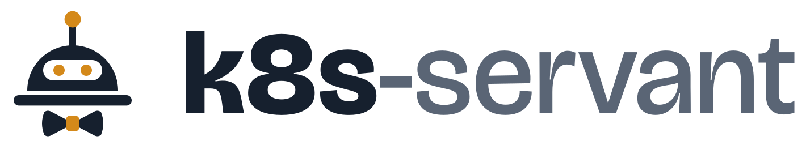

# k8s-servant

<picture>
  <source media="(prefers-color-scheme: dark)" srcset="docs/images/logo-dark.svg">
  
</picture>

[](https://github.com/k8s-servant/k8s-servant/actions/workflows/ci.yml)
[](https://scorecard.dev/viewer/?uri=github.com/k8s-servant/k8s-servant)
[](LICENSE)


[](https://k8s-servant.dev)

A **read-only AI SRE** for Kubernetes clusters. It looks at a cluster the way an
experienced cluster administrator would: it finds what is wrong, explains why with
evidence, says what to do about it, and remembers what it already told you. **It
never changes anything.** The language model is your choice: **Azure AI Foundry**,
**OpenAI**, **Anthropic**, a self-hosted model through **Ollama**, or any
OpenAI-compatible server ([choose a provider](#choose-a-model-provider)); results go to
the terminal and to an **MS Teams** channel.

> [!WARNING]
> **Early-stage project.** k8s-servant is young and has run on only a few clusters so
> far. Expect bugs and rough edges: findings can be wrong or incomplete, and settings,
> Helm values and commands may change in breaking ways before `v1.0` (watch for
> **⚠ BREAKING CHANGES** in the [changelog](https://github.com/k8s-servant/k8s-servant/releases)).
> It is read-only, so it cannot change your cluster, but **verify its findings before
> you act on them**, try it on a non-critical cluster first, and please
> [report what breaks](https://github.com/k8s-servant/k8s-servant/issues/new/choose).

## Contents

- [Description](#description)
- [What You Get](#what-you-get)
- [How It Works](#how-it-works)
- [Choose a Model Provider](#choose-a-model-provider)
- [Quickstart](#quickstart)
- [Deploying to a Cluster](#deploying-to-a-cluster)
- [Teaching the Agent](#teaching-the-agent)
- [Documentation](#documentation)
- [Roadmap](#roadmap)
- [Development](#development)
- [Contributing](#contributing)

---

## Description

**What it is:**

- **An assistant you can ask.** "Are there unhealthy pods?", "why is X pending?", "is
  Flux healthy?". It investigates with read-only tools and answers with evidence:
  object, field, event, time.
- **A watcher.** Every hour it runs a health check and remembers the result, so it
  reports problems as **new**, **still open** or **resolved** instead of repeating
  them. Changes go to MS Teams. When nothing changed, it does not even call the model.
- **A morning report.** On weekday mornings it posts how the cluster did since the
  previous report (on Mondays: the weekend), what came and went during the night, and
  what needs attention today.
- **Universal.** Nothing site-specific is in the code. What is special about your
  platform goes into an environment description and skills: plain Markdown, delivered
  through Helm values.
- **Learning.** It saves short "learned notes" (for example "this CronJob fails on
  Sundays by design") and reads them on later runs.
- **Built on standard tools.** It reads the cluster through
  [kubernetes-mcp-server](https://github.com/containers/kubernetes-mcp-server)
  (read-only), a guarded `kubectl`, and Prometheus / Alertmanager.

**What it is not:**

- **Not an operator.** It never changes the cluster. Asked to fix something, it
  describes the fix for you to apply.
- **Not a replacement for alerting.** Alertmanager stays the source of alerts. The
  agent adds investigation, grouping, prioritisation and explanation on top.
- **Not infallible.** A language model can misjudge or mix up names; every statement
  carries evidence so you can check it. See [Known limitations](docs/faq.md#known-limitations).
- **Runs in the cluster or on a laptop.** In a cluster it is one pod (the agent and a
  kubernetes-mcp-server sidecar), installed from the Helm chart in this repository
  ([Deploying to a Cluster](#deploying-to-a-cluster)).

---

## What You Get

All examples are real output from a test cluster, shortened and with names changed.

**A question:**

```console
$ k8s-servant ask "Are there any unhealthy pods or nodes?"
## Yes — one workload has an unhealthy pod; no unhealthy nodes were reported.

- DaemonSet kube-system/azure-cns: one pod is unhealthy.
  - azure-cns-x7k2p has 18 restarts; last state Error, exit code 137, at 03:05 UTC.
  - Its previous logs show a shutdown signal ("caught exit signal terminated").
  ...
### Suggested next steps
- Check why the container was terminated at 03:05 UTC on node aks-nodepool1-12345678-vmss000003 ...

-- 7 model calls, 14 tool calls, tools: cluster, knowledge, kubectl, mcp, memory, prometheus
```

**A health check** (also a Teams card when something is new or resolved):

```
# Health check — my-cluster — 2026-10-12 11:49 UTC
The cluster is broadly healthy ... two PodDisruptionBudgets match no pods and are firing alerts.
**2 new · 2 open · 0 resolved**

## New
- **[WARNING] PodDisruptionBudget orders-api matches no pods** — `pdb/shop/poddisruptionbudget/orders-api`
  status.expectedPods=0 ... KubePdbNotEnoughHealthyPods firing since 2026-09-23 ...
  Fix: delete the stale PDB or restore the matching workload.
```

**The morning report** (Teams card at 08:00):

```
# Morning report — my-cluster — Mon 12 Oct 2026
_Covers the time since Sun 11 Oct 15:47 (24 h)._

The cluster was mostly quiet ... The most urgent item today is the node
aks-nodepool1-12345678-vmss000003, still at 99% memory. ... A ResourceQuota block and a
stalled billing-api rollout cleared themselves overnight, and
KubeJobFailed stopped, but both are worth watching if they come back.

- Overnight: 4 new, 0 resolved, 2 came and went
- Health checks: 12: 9 full, 1 unchanged (model skipped), 2 failed
- Alerts firing now: 2 · Alerts that stopped overnight: 1
```

Formats, rules and the Teams cards: [docs/reports.md](docs/reports.md).

---

## How It Works

A question or a scheduled health check goes to the model with a system prompt (rules,
your environment description, cluster notes, learned notes, the skill catalog). The
model asks for read-only tools (summary tools first, then kubernetes-mcp-server and a
guarded `kubectl`, Prometheus and Alertmanager); the agent runs them, cuts large
outputs down and sends the results back until the model answers. Memory compares a
check's findings with the previous one (new / still open / resolved), and scheduled
checks skip the model entirely when nothing changed.

There is no agent framework: the loop is about 100 commented lines in
`k8s_servant/agent.py`. The diagram and the steps: [docs/how-it-works.md](docs/how-it-works.md);
the design and why: [docs/architecture.md](docs/architecture.md).

---

## Choose a Model Provider

Set `LLM_PROVIDER`; each provider has a full recipe (laptop `.env`, Helm values file,
sign-in, expected `doctor` line) in [docs/model-providers.md](docs/model-providers.md),
which also explains in plain words why the agent speaks three different APIs.

| `LLM_PROVIDER` | Model | Sign-in | Recipe | Helm example |
|---|---|---|---|---|
| `foundry` | GPT and others on Azure AI Foundry | Entra ID or API key | [Foundry](docs/model-providers.md#foundry-gpt-and-other-responses-models) | `examples/values-azure.yaml` |
| `anthropic` (Foundry endpoint) | Claude on Azure AI Foundry | Entra ID | [Claude on Foundry](docs/model-providers.md#claude-on-foundry) | `examples/values-azure-claude.yaml` |
| `openai` | OpenAI | API key | [OpenAI](docs/model-providers.md#openai) | `examples/values-openai.yaml` |
| `anthropic` | Claude from Anthropic | API key | [Anthropic](docs/model-providers.md#anthropic) | `examples/values-anthropic.yaml` |
| `ollama` | A model you host, e.g. in the cluster | none | [Ollama](docs/model-providers.md#ollama-laptop-and-in-cluster) | `examples/values-ollama.yaml` |
| `openai-compatible` | vLLM, LiteLLM, Gemini, LM Studio, ... | API key (optional) | [OpenAI-compatible](docs/model-providers.md#openai-compatible-vllm-litellm-gemini-and-others) | `examples/values-minimal.yaml` |

---

## Quickstart

You need Python 3.12 or newer, `kubectl`, and a model: a local
[Ollama](https://ollama.com/) (`ollama pull qwen3`) or an API key from Anthropic or
OpenAI.

```bash
git clone https://github.com/k8s-servant/k8s-servant.git && cd k8s-servant
python3 -m venv .venv && .venv/bin/pip install -e . && source .venv/bin/activate
export LLM_PROVIDER=ollama LLM_MODEL=qwen3        # or anthropic / openai with LLM_API_KEY_FILE
export CLUSTER_NAME=demo MCP_URL=                 # kubectl only; reads your current context
k8s-servant doctor
k8s-servant ask "Are there any unhealthy pods? Why?"
```

The full walkthrough, with a throwaway kind cluster that has something broken in it,
a safe way to keep the API key, the MCP server and Prometheus:
[docs/getting-started.md](docs/getting-started.md). Every setting:
[docs/configuration.md](docs/configuration.md).

---

## Deploying to a Cluster

In a cluster the agent is one pod with two containers, the agent (`k8s-servant serve`)
and the kubernetes-mcp-server sidecar, installed from the Helm chart published as an
OCI artifact. The full guide is [docs/deployment.md](docs/deployment.md). In short:

| Artifact | Where |
|---|---|
| Agent image | `ghcr.io/k8s-servant/k8s-servant` (signed with cosign keyless; SBOM and provenance attached) |
| MCP sidecar image | upstream `ghcr.io/containers/kubernetes-mcp-server` |
| Helm chart | `oci://ghcr.io/k8s-servant/charts/k8s-servant` (source: `charts/k8s-servant/`) |

1. **Model access.** Pick a provider ([recipes](docs/model-providers.md)) and give
   the pod a way to call it: an API key in a Secret (OpenAI, Anthropic, ...), nothing
   for an in-cluster Ollama, or for Foundry on AKS a Workload Identity
   (`scripts/setup-foundry.sh`, `scripts/setup-workload-identity.sh`).
2. **Credentials.** The chart never creates Secrets. The API key and the Teams webhook
   URL come from a Secret you create (kubectl, External Secrets, Sealed Secrets, ...)
   or from a file you mount (Secrets Store CSI driver), always read as files
   ([how](docs/deployment.md#credentials-bring-your-own-secrets)).
3. **Values.** Start from one example, plus `examples/knowledge-values.yaml` (what is
   normal on your platform):

   | Example | For |
   |---|---|
   | `examples/values-minimal.yaml` | any cluster: an OpenAI-compatible endpoint with an API key, and the Teams webhook, from kubectl-created Secrets |
   | `examples/values-openai.yaml` | any cluster: OpenAI, key from a Secret |
   | `examples/values-anthropic.yaml` | any cluster: Claude from Anthropic, key from a Secret |
   | `examples/values-ollama.yaml` | any cluster: an in-cluster Ollama, no key |
   | `examples/values-azure.yaml` | AKS: Foundry with Workload Identity, Teams webhook synced from Key Vault by External Secrets |
   | `examples/values-azure-claude.yaml` | AKS: Claude on Foundry with Workload Identity |
   | `examples/values-azure-csi.yaml` | AKS without Kubernetes Secrets: Teams webhook mounted from Key Vault by the CSI driver |
4. **Install:**
   ```bash
   helm install k8s-servant oci://ghcr.io/k8s-servant/charts/k8s-servant \
     -n k8s-servant --create-namespace -f my-values.yaml
   ```
   With Flux, use `examples/flux-helmrelease.yaml` instead.
5. **Check:** the pod shows 2/2 Running, then run
   `kubectl -n k8s-servant exec deploy/k8s-servant -c agent -- k8s-servant doctor`,
   and `kubectl auth can-i get secrets --as=system:serviceaccount:k8s-servant:k8s-servant -A`
   must print `no`.

---

## Teaching the Agent

The agent learns about your platform from three kinds of Markdown:

- **Environment description:** what this platform is and what is normal here.
- **Cluster notes:** what is special about one cluster.
- **Skills:** step-by-step investigation procedures, as `SKILL.md` files.

Five generic skills ship with the agent: `cluster-health-check`,
`workload-troubleshooting`, `node-troubleshooting`, `flux-gitops-status` and
`prometheus-queries`. A complete example for a fictional platform is in
`examples/knowledge-values.yaml`. Add your own through Helm values
(`knowledge.environment`, `knowledge.clusterNotes`, `knowledge.extraSkills`) and test
them locally with `k8s-servant --values <file> ...`. The agent also keeps learned notes
of its own ([docs/memory.md](docs/memory.md)).
How it works step by step: [docs/how-the-agent-learns.md](docs/how-the-agent-learns.md).
How to write it: [docs/knowledge-and-skills.md](docs/knowledge-and-skills.md).

**The most effective way to improve the agent** is to write down what "normal" means
here: when the agent reports something that is expected, add one line to the
environment description or the cluster notes instead of changing code.

---

## Documentation

The documentation is published at **[k8s-servant.dev](https://k8s-servant.dev)**, with
search and navigation. The same pages, in the repository:

| Document | What it covers |
|---|---|
| [docs/getting-started.md](docs/getting-started.md) | The full local quickstart on a throwaway kind cluster, then the MCP server, Prometheus and your platform's knowledge |
| [docs/configuration.md](docs/configuration.md) | Every setting (environment variables), and which values are secrets locally and in the cluster |
| [docs/teams-setup.md](docs/teams-setup.md) | Creating the Teams Workflows webhook, storing it and testing it |
| [docs/how-it-works.md](docs/how-it-works.md) | The flow from a question to an answer, step by step, and the repository structure |
| [docs/faq.md](docs/faq.md) | Frequent questions, known limitations, cost and rate limits |
| [docs/architecture.md](docs/architecture.md) | How the agent is built and why: components, loop, summary tools, MCP/kubectl fallback, safety layers, scheduler, logging |
| [docs/tools.md](docs/tools.md) | Every tool: what it reads, its safety rules, when the model uses it |
| [docs/reports.md](docs/reports.md) | Health checks, fingerprints, skipping unchanged checks, the morning report, Teams cards and posting rules |
| [docs/deployment.md](docs/deployment.md) | Deploying to a cluster: Helm/Flux install, Workload Identity, network, values, checks, day-2 operations |
| [docs/cli.md](docs/cli.md) | The `k8s-servant` command: every option, examples, exit codes |
| [docs/how-the-agent-learns.md](docs/how-the-agent-learns.md) | How knowledge reaches the model: loading, the system prompt (example and size), learned notes, skills loaded on demand |
| [docs/knowledge-and-skills.md](docs/knowledge-and-skills.md) | Teaching the agent: environment description, cluster notes, writing and testing skills |
| [docs/technology.md](docs/technology.md) | What it is built with and why: Python libraries, the model, MCP, Prometheus, Teams, alternatives considered |
| [docs/memory.md](docs/memory.md) | What the agent remembers: findings (new / still open / resolved), run history, learned notes |
| [docs/security.md](docs/security.md) | Read-only guarantees, what data leaves the cluster, credentials |
| [docs/running-from-a-mirror.md](docs/running-from-a-mirror.md) | Running from your own registry: mirroring the image, chart and sidecar with their signatures, a private configuration repository, upgrades, no fork |
| [docs/verifying-releases.md](docs/verifying-releases.md) | Checking that an image or chart was built and signed by this project: cosign keyless, admission policies, SBOM and provenance |
| [docs/data-processing.md](docs/data-processing.md) | What happens to cluster data before and after the model: reduction, size caps, answer checks, facts computed in Python, and what is not done (no redaction) |
| [docs/troubleshooting.md](docs/troubleshooting.md) | Symptoms, causes and fixes, from the first real runs |
| [docs/ci-and-releases.md](docs/ci-and-releases.md) | CI workflows, required checks, PR title rules, release-please and published artifacts |
| [docs/code-walkthrough.md](docs/code-walkthrough.md) | A guided tour of the code in six parts: one question end to end, the model layer, tools and safety, the scheduler and memory, the tests, packaging and release |
| [docs/development.md](docs/development.md) | Working on the code: code map, rules, tests and fakes, recipes (add a setting, a check, a tool, a skill, a command) |
| [docs/model-providers.md](docs/model-providers.md) | Why three APIs, and a full recipe per provider: Foundry, Claude on Foundry, OpenAI, Anthropic, Ollama, OpenAI-compatible; migrating from `FOUNDRY_*` |
| [docs/foundry-concepts.md](docs/foundry-concepts.md) | What Azure AI Foundry is: resources, deployments, quota, cost, access, network |
| [docs/foundry-setup.md](docs/foundry-setup.md) | Setting up the model in Azure AI Foundry, step by step |
| [docs/roadmap.md](docs/roadmap.md) | What exists, what is next and ideas for later |
| [Releases](https://github.com/k8s-servant/k8s-servant/releases) | What changed, release by release (also in `CHANGELOG.md`) |

---

## Roadmap

Available today: the agent and CLI (`ask`, `check`, `report`, `serve`, `doctor`, ...)
on five model providers, MCP with kubectl fallback, knowledge and skills, scheduled
health checks with memory, the morning report, MS Teams cards, Prometheus/Alertmanager
tools, summary tools with skipping of unchanged checks, a signed container image and
the Helm chart.

Where it is going: k8s-servant should feel like **one more person on the team**. Next
comes an **initial scan** in which the agent drafts the
description of your platform ([#35](https://github.com/k8s-servant/k8s-servant/issues/35)),
then a **two-way MS Teams bot** for the whole fleet
([#27](https://github.com/k8s-servant/k8s-servant/issues/27)), a **command centre** web
view ([#38](https://github.com/k8s-servant/k8s-servant/issues/38)),
a **scoreboard** that shows how often it is right
([#28](https://github.com/k8s-servant/k8s-servant/issues/28)), cost budgets, and later
**approved runbooks** such as rolling node restarts after patching, unlocked step by step
as the scoreboard earns trust, and developer self-service. Being read-only stays the
default. Details: [docs/roadmap.md](docs/roadmap.md) and the
[vision](docs/superpowers/specs/2026-10-17-teammate-vision-design.md).

---

## Development

```bash
.venv/bin/pytest            # full test suite (includes documentation checks)
.venv/bin/pytest -k kubectl # one area
```

How to work on the code, with recipes for common changes:
[docs/development.md](docs/development.md). The short form of the conventions is in
[AGENTS.md](AGENTS.md): read-only always, no shell, stdout carries only the answer,
settings come only from environment variables, and comments explain *why*.

---

## Contributing

Bug reports, documentation fixes, new skills and code are welcome. Read
[CONTRIBUTING.md](CONTRIBUTING.md) before opening a pull request. Pull request titles
follow [Conventional Commits](https://www.conventionalcommits.org/); releases and the
changelog are produced by release-please.

## Security

Please do not report vulnerabilities in public issues. See the
[security policy](https://github.com/k8s-servant/.github/blob/main/SECURITY.md) for how
to report them privately.

## License

[Apache-2.0](LICENSE)
