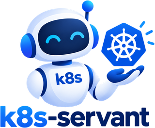

# k8s-servant



[](https://github.com/k8s-servant/k8s-servant/actions/workflows/ci.yml)
[](https://scorecard.dev/viewer/?uri=github.com/k8s-servant/k8s-servant)
[](LICENSE)


A **read-only AI SRE** for Kubernetes clusters. It looks at a cluster the way an
experienced cluster administrator would: it finds what is wrong, explains why with
evidence, says what to do about it, and remembers what it already told you. **It
never changes anything.** The language model runs in **Azure AI Foundry** (other
OpenAI-compatible endpoints are experimental); results go to the terminal and to an
**MS Teams** channel.

> **Status:** early. The API, settings and Helm values may change in breaking ways
> before `v1.0`. Feedback and contributions are welcome.

## Table of Contents

- [Description](#description)
- [Repository Structure](#repository-structure)
- [What You Get](#what-you-get)
- [How It Works](#how-it-works)
- [Quickstart (Local)](#quickstart-local)
- [Deploying to a Cluster](#deploying-to-a-cluster)
- [Configuration](#configuration)
  - [Cluster and model](#cluster-and-model)
  - [Reading the cluster](#reading-the-cluster)
  - [The agent loop](#the-agent-loop)
  - [Knowledge and memory](#knowledge-and-memory)
  - [Prometheus and Alertmanager (optional)](#prometheus-and-alertmanager-optional)
  - [MS Teams](#ms-teams)
  - [Scheduling (`k8s-servant serve`)](#scheduling-k8s-servant-serve)
  - [Logging](#logging)
- [Secrets: Local vs Cluster](#secrets-local-vs-cluster)
- [MS Teams Setup](#ms-teams-setup)
- [Cost and Limits](#cost-and-limits)
- [Teaching the Agent](#teaching-the-agent)
- [Known Limitations](#known-limitations)
- [FAQ](#faq)
- [Documentation](#documentation)
- [Roadmap](#roadmap)
- [Development](#development)
- [Contributing](#contributing)
- [Security](#security)
- [License](#license)

---

## Description

**What it is:**

- **An assistant you can ask.** "Are there unhealthy pods?", "why is X pending?", "is
  Flux healthy?". It investigates with read-only tools and answers with evidence:
  object, field, event, time.
- **A watcher.** Every hour it runs a health check and remembers the result, so it
  reports problems as **new**, **still open** or **resolved** instead of repeating
  them. Changes go to MS Teams. When nothing changed, it does not even call the model.
- **A morning report.** On weekday mornings it posts how the cluster did since the
  previous report (on Mondays: the weekend), what came and went during the night, and
  what needs attention today.
- **Universal.** Nothing site-specific is in the code. What is special about your
  platform goes into an environment description and skills: plain Markdown, delivered
  through Helm values.
- **Learning.** It saves short "learned notes" (for example "this CronJob fails on
  Sundays by design") and reads them on later runs.
- **Built on standard tools.** It reads the cluster through
  [kubernetes-mcp-server](https://github.com/containers/kubernetes-mcp-server)
  (read-only), a guarded `kubectl`, and Prometheus / Alertmanager.

**What it is not:**

- **Not an operator.** It never changes the cluster. Asked to fix something, it
  describes the fix for you to apply.
- **Not a replacement for alerting.** Alertmanager stays the source of alerts. The
  agent adds investigation, grouping, prioritisation and explanation on top.
- **Not infallible.** A language model can misjudge or mix up names; every statement
  carries evidence so you can check it. See [Known limitations](#known-limitations).
- **Runs in the cluster or on a laptop.** In a cluster it is one pod (the agent and a
  kubernetes-mcp-server sidecar), installed from the Helm chart in this repository
  ([Deploying to a Cluster](#deploying-to-a-cluster)).

---

## Repository Structure

```text
k8s-servant/
├── k8s_servant/                    # The agent (Python package, `k8s-servant` command)
│   ├── cli.py                      # Commands: ask, check, report, serve, findings, history, notes, tools, doctor
│   ├── config.py                   # Every setting, from environment variables; logging
│   ├── agent.py                    # System prompt + tool-calling loop (~100 lines)
│   ├── llm.py                      # Model client: Entra ID or API key, reasoning effort, token log, error advice
│   ├── runtime.py                  # Wires tools, prompt and model for one run
│   ├── knowledge.py                # Environment description, cluster notes, skills; load_skill tool
│   ├── healthcheck.py              # One health check; skipping the model when nothing changed
│   ├── findings.py                 # Findings, fingerprints, parsing the model's JSON
│   ├── memory.py                   # SQLite memory (findings, runs, meta) + learned notes; save_note tool
│   ├── report.py                   # The morning report
│   ├── teams.py                    # Adaptive Cards, posting to the Teams Workflows webhook
│   ├── scheduler.py                # `serve`: hourly checks + the morning report, heartbeat, SIGTERM
│   └── tools/
│       ├── registry.py             # Common Tool shape, registry, output size cap
│       ├── cluster_tools.py        # cluster_problems + warning_events: summaries for large clusters
│       ├── mcp_tools.py            # Tools from kubernetes-mcp-server
│       ├── kubectl_tool.py         # Guarded read-only kubectl (allow-listed verbs and flags)
│       └── prometheus_tool.py      # PromQL, Alertmanager, alert history
├── charts/k8s-servant/             # Helm chart: agent + MCP sidecar, RBAC, PVC (values.yaml: every key commented)
│   ├── Chart.yaml                  # version = appVersion = image version
│   ├── values.yaml                 # Defaults
│   ├── templates/                  # Deployment, ConfigMaps (settings, knowledge, MCP), RBAC, PVC, extraObjects
│   └── knowledge/skills/           # Built-in generic skills, one SKILL.md each (rendered into the knowledge ConfigMap)
│       ├── cluster-health-check/
│       ├── workload-troubleshooting/
│       ├── node-troubleshooting/
│       ├── flux-gitops-status/
│       └── prometheus-queries/
├── examples/
│   ├── knowledge-values.yaml       # Example environment description and cluster notes for a fictional platform
│   ├── values-azure.yaml           # The complete Azure setup: Foundry + Workload Identity + Key Vault via External Secrets
│   ├── values-azure-csi.yaml       # Azure without Kubernetes Secrets: Key Vault mounted by the CSI driver
│   ├── values-minimal.yaml         # Any cluster: API key and Teams webhook from kubectl-created Secrets
│   └── flux-helmrelease.yaml       # Flux HelmRelease installing the OCI chart
├── deploy/local/
│   └── mcp-config.toml             # kubernetes-mcp-server config for local runs (read-only, core toolset)
├── scripts/
│   ├── setup-foundry.sh            # Create the Foundry resource + model deployment, grant your role
│   └── setup-workload-identity.sh  # The pod's managed identity: federated credential, Key Vault secret + Foundry roles
├── tests/                          # pytest suite: one file per module, fakes.py, documentation checks
├── docs/                           # Documentation (see Documentation below)
│   └── images/logo.png             # Project logo
├── .github/                        # CI (GitHub Actions), release-please, issue and PR templates
├── Dockerfile                      # Image: Python alpine, pinned kubectl, non-root, read-only root fs
├── pyproject.toml                  # Package, dependencies, the `k8s-servant` entry point
├── .env.example                    # Template for local settings (no secrets)
├── CHANGELOG.md                    # What changed (generated by release-please)
├── CONTRIBUTING.md                 # How to contribute
└── CLAUDE.md                       # Conventions for AI coding sessions
```

---

## What You Get

All examples are real output from a test cluster, shortened and with names changed.

**A question:**

```console
$ k8s-servant ask "Are there any unhealthy pods or nodes?"
## Yes — one workload has an unhealthy pod; no unhealthy nodes were reported.

- DaemonSet kube-system/azure-cns: one pod is unhealthy.
  - azure-cns-x7k2p has 18 restarts; last state Error, exit code 137, at 03:05 UTC.
  - Its previous logs show a shutdown signal ("caught exit signal terminated").
  ...
### Suggested next steps
- Check why the container was terminated at 03:05 UTC on node aks-nodepool1-12345678-vmss000003 ...

-- 7 model calls, 14 tool calls, tools: cluster, knowledge, kubectl, mcp, memory, prometheus
```

**A health check** (also a Teams card when something is new or resolved):

```
# Health check — my-cluster — 2026-10-12 11:49 UTC
The cluster is broadly healthy ... two PodDisruptionBudgets match no pods and are firing alerts.
**2 new · 2 open · 0 resolved**

## New
- **[WARNING] PodDisruptionBudget orders-api matches no pods** — `pdb/shop/poddisruptionbudget/orders-api`
  status.expectedPods=0 ... KubePdbNotEnoughHealthyPods firing since 2026-09-23 ...
  Fix: delete the stale PDB or restore the matching workload.
```

**The morning report** (Teams card at 08:00):

```
# Morning report — my-cluster — Mon 12 Oct 2026
_Covers the time since Sun 11 Oct 15:47 (24 h)._

The cluster was mostly quiet ... The most urgent item today is the node
aks-nodepool1-12345678-vmss000003, still at 99% memory. ... A ResourceQuota block and a
stalled billing-api rollout cleared themselves overnight, and
KubeJobFailed stopped, but both are worth watching if they come back.

- Overnight: 4 new, 0 resolved, 2 came and went
- Health checks: 12: 9 full, 1 unchanged (model skipped), 2 failed
- Alerts firing now: 2 · Alerts that stopped overnight: 1
```

Formats, rules and the Teams cards: [docs/reports.md](docs/reports.md).

---

## How It Works

```
 you ──▶ k8s-servant ask / check / report ──┐
 scheduler (serve): hourly + 08:00 ─────────┤
                                            ▼
              scheduled check: summary tools first, without the model
              (cluster_problems + alerts) ── unchanged? ──▶ "unchanged", done (0 tokens)
                                            │ changed / manual / every 6 h
                                            ▼
                                       agent loop ──────▶ chat model (Azure AI Foundry)
                                       │  ▲                (e.g. gpt-5.4-mini, reasoning medium)
                           tool calls  ▼  │ results (cut to 8,000 chars)
 ┌──────────────────┬───────────────┬──────────────┬──────────────┬───────────┬──────────┐
 cluster_problems   kubernetes-mcp  kubectl         Prometheus /   load_skill  save_note
 warning_events     server          (fallback,      Alertmanager   (skills)    (notes)
 (summaries)        (read-only)     allow-listed)
 └──────────────────┴───────┬───────┘
                            ▼
                Kubernetes API (read-only; Secrets never read)

 memory (DATA_DIR): findings (new / still open / resolved), run history, learned notes
 results ──▶ stdout, history, MS Teams (changes after a check; the morning report)
```

1. A question (or "run the health check skill") and a system prompt go to the model.
   The system prompt holds the rules, the environment description, cluster notes,
   learned notes and the skill catalog.
2. The model asks for tools. For health it starts with the **summary tools**:
   `cluster_problems` returns only what is unhealthy across the whole cluster, and
   `warning_events` returns grouped Warning events without policy-scan noise. Then it
   follows each lead with MCP tools and kubectl (describe, events, logs, metrics).
3. The agent runs the tools, cuts large outputs down and sends the results back. This
   repeats until the model answers; at most 25 rounds.
4. A health check ends with a JSON list of findings. Memory compares them with the
   previous check (new / still open / resolved) and decides what to post.
5. Scheduled checks first compare the summary with the last full check; if nothing
   changed, the model is not called at all.

There is no agent framework: the loop is about 100 commented lines in
`k8s_servant/agent.py`. Why, and the rest of the design:
[docs/architecture.md](docs/architecture.md). Every tool: [docs/tools.md](docs/tools.md).

---

## Quickstart (Local)

Prerequisites:
- Python 3.12+;
- `kubectl` with a context for the cluster;
- a chat model with tool calling. Today that is a deployment in **Azure AI Foundry**
  (run `scripts/setup-foundry.sh`, or follow [docs/foundry-setup.md](docs/foundry-setup.md))
  plus the `az` CLI for Entra ID sign-in. Other OpenAI-compatible endpoints are
  experimental (see [Cluster and model](#cluster-and-model));
- optional: Node.js (to run kubernetes-mcp-server with `npx`).

```bash
# 1. Install
python3 -m venv .venv
.venv/bin/pip install -e '.[dev]'
source .venv/bin/activate

# 2. Configure (see the table below)
cp .env.example .env            # set FOUNDRY_ENDPOINT, FOUNDRY_DEPLOYMENT, CLUSTER_NAME
                                #   (no secrets in it: see "Secrets: local vs cluster")
set -a; source .env; set +a
az login                        # the agent uses your Entra ID session for Foundry
kubectl config current-context  # the agent reads the cluster of this context

# 3. Optional but recommended, each in its own terminal:
#    the MCP server (the binary from its GitHub releases, or through npm):
npx -y kubernetes-mcp-server@0.0.67 --config deploy/local/mcp-config.toml
#    Prometheus and Alertmanager (then set PROMETHEUS_URL=http://localhost:9090
#    and ALERTMANAGER_URL=http://localhost:9093 in .env). Port-forwards drop now and
#    then ("lost connection to pod"); restart them when doctor reports FAIL.
#    Adjust namespace and service names to your monitoring stack.
kubectl -n monitoring port-forward svc/prometheus-operated 9090
kubectl -n monitoring port-forward svc/alertmanager-operated 9093

# 4. Use the same knowledge files as the cluster (your platform + this cluster)
alias kss='k8s-servant --values examples/knowledge-values.yaml --values my-values.yaml'

# 5. Check, then use
kss doctor
kss ask "Are there any unhealthy pods or nodes?"
kss check            # one health check; memory in ./.data
kss findings         # what is open now
kss report           # the morning report, now
kss check --post     # ... and to Teams (see "MS Teams setup")
kss serve            # the scheduler, as it will run in the cluster (Ctrl-C to stop)
```

`k8s-servant doctor` checks configuration, knowledge, memory, MCP, kubectl, RBAC,
Prometheus, Alertmanager, Teams and the model, one line each. Run it first when
something does not work, then see [docs/troubleshooting.md](docs/troubleshooting.md).
All commands: [docs/cli.md](docs/cli.md).

---

## Deploying to a Cluster

In a cluster the agent is one pod with two containers, the agent (`k8s-servant serve`)
and the kubernetes-mcp-server sidecar, installed from the Helm chart published as an
OCI artifact. The full guide is [docs/deployment.md](docs/deployment.md). In short:

| Artifact | Where |
|---|---|
| Agent image | `ghcr.io/k8s-servant/k8s-servant` (signed with cosign keyless; SBOM and provenance attached) |
| MCP sidecar image | upstream `ghcr.io/containers/kubernetes-mcp-server` |
| Helm chart | `oci://ghcr.io/k8s-servant/charts/k8s-servant` (source: `charts/k8s-servant/`) |

1. **Model access.** Deploy a chat model (`scripts/setup-foundry.sh`) and give the pod
   an identity that may call it. On AKS, `scripts/setup-workload-identity.sh` creates a
   managed identity with a federated credential for the agent's ServiceAccount, read
   access to the Teams webhook secret in Key Vault, and the model role.
2. **Values.** Start from `examples/values-azure.yaml` (cluster name, model endpoint,
   identity client ID, Prometheus, Teams) and `examples/knowledge-values.yaml` (what is
   normal on your platform).
3. **Install:**
   ```bash
   helm install k8s-servant oci://ghcr.io/k8s-servant/charts/k8s-servant \
     -n k8s-servant --create-namespace -f my-values.yaml
   ```
   With Flux, use `examples/flux-helmrelease.yaml` instead.
4. **Check:** the pod shows 2/2 Running, then run
   `kubectl -n k8s-servant exec deploy/k8s-servant -c agent -- k8s-servant doctor`,
   and `kubectl auth can-i get secrets --as=system:serviceaccount:k8s-servant:k8s-servant -A`
   must print `no`.

---

## Configuration

All settings are environment variables. Locally they come from `.env`; in the cluster
from the Helm chart (`appConfig` in the values, rendered into a ConfigMap). A test keeps this table in sync with
`k8s_servant/config.py`.

### Cluster and model

| Variable | Default | Meaning |
|---|---|---|
| `CLUSTER_NAME` | `unknown-cluster` | Friendly cluster name used in answers, reports and Teams cards. |
| `FOUNDRY_ENDPOINT` | *(required)* | Model endpoint. For Azure AI Foundry the resource endpoint, e.g. `https://<name>.openai.azure.com/`; `/openai/v1/` is appended automatically. A URL that already includes a path (e.g. `https://api.openai.com/v1`, `http://localhost:11434/v1`) is used as-is: other OpenAI-compatible endpoints (experimental), authenticated with `FOUNDRY_API_KEY`. |
| `FOUNDRY_DEPLOYMENT` | *(required)* | Model **deployment** name in Foundry (the model name for other endpoints). |
| `FOUNDRY_API_KEY` | *(empty)* | API key. Empty = Entra ID (`az login` locally, Workload Identity in the cluster), the recommended way for Azure AI Foundry. Required for other OpenAI-compatible endpoints. |
| `FOUNDRY_API_KEY_FILE` | *(empty)* | File containing the API key (the mounted Secret in the cluster, set by the chart from `llmApiKey.existingSecret`); wins over `FOUNDRY_API_KEY`. An unreadable or empty file stops the agent with an error. |
| `FOUNDRY_TOKEN_SCOPE` | `https://ai.azure.com/.default` | Scope requested for the Entra ID token. |
| `FOUNDRY_TIMEOUT_SECONDS` | `120` | Timeout of one model request (the SDK retries up to 3 times; retries are logged). |
| `FOUNDRY_REASONING_EFFORT` | `medium` | How hard a reasoning model thinks: `none`, `minimal`, `low`, `medium`, `high`. gpt-5.4-mini does not reason at all unless asked. Empty = not sent (for models that reject it). |

### Reading the cluster

| Variable | Default | Meaning |
|---|---|---|
| `MCP_URL` | `http://localhost:8080/mcp` | kubernetes-mcp-server endpoint. Empty = MCP disabled, kubectl only. |
| `MCP_TIMEOUT_SECONDS` | `60` | Timeout of one MCP tool call; a timed-out call reaches the model as an `ERROR:` result. |
| `KUBECTL_PATH` | `kubectl` | kubectl binary (fallback tool and summary tools). |
| `KUBECTL_TIMEOUT_SECONDS` | `30` | Timeout of one kubectl call (also used by `cluster_problems` and `warning_events`). |
| `EVENTS_EXCLUDE_REASONS` | `PolicyViolation` | Warning event reasons `warning_events` hides unless asked (comma-separated). Policy scanners such as Kyverno emit thousands of these. Empty = hide nothing. |

### The agent loop

| Variable | Default | Meaning |
|---|---|---|
| `MAX_ITERATIONS` | `25` | Maximum model round-trips per question. |
| `TOOL_OUTPUT_MAX_CHARS` | `8000` | Tool output longer than this is cut (head and tail kept). Every later model call resends it, so it drives the token cost. |

### Knowledge and memory

| Variable | Default | Meaning |
|---|---|---|
| `KNOWLEDGE_DIR` | chart folder `charts/k8s-servant/knowledge` | Folder with `environment.md`, `cluster.md` and skills. |
| `DATA_DIR` | `.data` | Memory folder: findings, run history, learned notes ([docs/memory.md](docs/memory.md)). `/data` in the cluster. |
| `NOTES_MAX_CHARS` | `8000` | How much of the newest learned notes goes into the system prompt. |

### Prometheus and Alertmanager (optional)

| Variable | Default | Meaning |
|---|---|---|
| `PROMETHEUS_URL` | *(empty)* | Prometheus base URL; enables the PromQL tools and "alerts that stopped overnight" in the morning report. |
| `ALERTMANAGER_URL` | *(empty)* | Alertmanager base URL; enables the alerts tool and "alerts firing now". |
| `PROMETHEUS_TIMEOUT_SECONDS` | `30` | Timeout of one Prometheus or Alertmanager request. |
| `ALERTS_IGNORE_NAMES` | `Watchdog,InfoInhibitor` | Always-firing alerts, left out of the morning report and of the "anything changed?" comparison. Empty = use all. |

### MS Teams

| Variable | Default | Meaning |
|---|---|---|
| `TEAMS_WEBHOOK_URL` | *(empty)* | Teams Workflows webhook URL (a credential). |
| `TEAMS_WEBHOOK_URL_FILE` | *(empty)* | File containing the webhook URL (the mounted Secret in the cluster); wins over `TEAMS_WEBHOOK_URL`. |
| `TEAMS_POST_MODE` | `changes` | `changes`: post a check only when something is new or resolved; `always`; `off`. The morning report is posted unless `off`. |

### Scheduling (`k8s-servant serve`)

| Variable | Default | Meaning |
|---|---|---|
| `CHECK_INTERVAL_MINUTES` | `60` | Minutes between scheduled health checks. |
| `CHECK_SKIP_UNCHANGED` | `true` | Scheduled checks skip the model when problems and firing alerts are identical to the last full check (saves ~150k tokens per check). Manual `check` and the morning report always run in full. |
| `CHECK_FULL_INTERVAL_HOURS` | `6` | Run a full check at least this often even when nothing changed. |
| `JOB_TIMEOUT_MINUTES` | `30` | A scheduled check or morning report running longer than this is cancelled. |
| `MORNING_REPORT_ENABLED` | `true` | Post the morning report. |
| `MORNING_REPORT_TIME` | `08:00` | Local time of the morning report. |
| `MORNING_REPORT_TIMEZONE` | `UTC` | IANA time zone of `MORNING_REPORT_TIME`, e.g. `Europe/Berlin` (summer time handled). |
| `MORNING_REPORT_WEEKDAYS_ONLY` | `true` | Skip Saturdays and Sundays (Monday's report then covers the weekend). |
| `HEARTBEAT_FILE` | *(empty)* | File touched every scheduler loop for a liveness probe (`/tmp/heartbeat` in the cluster). |

### Logging

| Variable | Default | Meaning |
|---|---|---|
| `LOG_LEVEL` | `INFO` | `DEBUG`, `INFO` or `WARNING`. Logs go to stderr; answers go to stdout. |

---

## Secrets: Local vs Cluster

`.env` is only a convenience for running the CLI on a laptop: it collects your local
settings so you can load them into your shell with `set -a; source .env; set +a`. The
agent itself only reads environment variables. In the cluster there is no `.env` at
all.

Almost nothing in `.env` is secret:

| Value | Secret? | Local (laptop) | Cluster |
|---|---|---|---|
| Endpoints, names, URLs of Prometheus etc., timeouts | No | `.env` | ConfigMap rendered by the Helm chart |
| **Access to the model (Azure AI Foundry)** | — | your `az login` session; nothing is stored in `.env` | **Workload Identity**: the pod's ServiceAccount is federated with a managed identity that has *Cognitive Services OpenAI User* on the Foundry resource. No key anywhere |
| `FOUNDRY_API_KEY` | **Yes** | leave it empty for Azure AI Foundry (keys only for quick experiments); required for other OpenAI-compatible endpoints | for Azure AI Foundry not used; otherwise a Kubernetes Secret you create, named in `llmApiKey.existingSecret`, mounted as a file (`FOUNDRY_API_KEY_FILE`) |
| **`TEAMS_WEBHOOK_URL`** | **Yes**: anyone with it can post to the channel | load it from your secret store into your shell (below) | A Kubernetes Secret you create any way you like (kubectl, External Secrets, Sealed Secrets, ...), named in `teamsWebhook.existingSecret`, mounted as a file and read through `TEAMS_WEBHOOK_URL_FILE`. `examples/values-azure.yaml` syncs it from Azure Key Vault with External Secrets |

In the Azure example, one managed identity does both jobs: it calls the model and
reads the webhook secret from Key Vault (for External Secrets).
`scripts/setup-workload-identity.sh` creates it
([docs/deployment.md](docs/deployment.md#1-workload-identity-aks)). The chart itself
never creates Secrets; see
[Credentials](docs/deployment.md#credentials-bring-your-own-secrets).

**What protects `.env` locally.** It is listed in `.gitignore`, so git never commits it,
and neither the agent's memory (`.data/`). It is still a plain-text file on your disk,
readable by anything that runs as you (backups, sync tools). So keep secrets out of it:

```bash
# Recommended: load the webhook URL from Key Vault into this shell session only.
set -a; source .env; set +a
export TEAMS_WEBHOOK_URL=$(az keyvault secret show --vault-name my-keyvault \
  --name teams-webhook-url --query value -o tsv)

# Alternative: a private file outside the repository, read the same way as in the pod.
mkdir -p ~/.config/k8s-servant && chmod 700 ~/.config/k8s-servant
printf '%s' '<webhook-url>' > ~/.config/k8s-servant/webhook-url && chmod 600 ~/.config/k8s-servant/webhook-url
export TEAMS_WEBHOOK_URL_FILE=~/.config/k8s-servant/webhook-url
```

Do not paste secrets directly into commands you type: they end up in your shell
history. The agent never writes the webhook URL to its logs, history or Teams cards.

---

## MS Teams Setup

The agent posts through a Teams **Workflows** webhook (the old "Incoming Webhook"
connectors were retired). The cards look and behave as described in
[docs/reports.md](docs/reports.md#teams-cards).

1. **Webhook.** In the channel, **…** → **Workflows** → template **"Send webhook
   alerts to a channel"** → name it (e.g. *k8s-servant my-cluster*) → **Save**, and copy
   the URL. Add a co-owner to the flow so it does not depend on one person. Reusing the
   webhook of an existing channel (for example the one Alertmanager posts to) also works.
2. **Secret store.** The URL is a password. Keep it in a secret store (for example
   Azure Key Vault, secret `teams-webhook-url` in `my-keyvault`). In the cluster the
   agent reads it from a Kubernetes Secret named in `teamsWebhook.existingSecret`,
   which you create with kubectl, External Secrets or any other tool
   ([how](docs/deployment.md#credentials-bring-your-own-secrets)).
3. **Test.** Load the URL into your shell (see
   [Secrets: local vs cluster](#secrets-local-vs-cluster)). `k8s-servant doctor` should
   show `[OK] teams`. Then `TEAMS_POST_MODE=always k8s-servant check --post` posts a
   check card, and `k8s-servant report --post` the morning report.

Cards stay under Teams' size limit: with many findings, details are shortened and
lists end with "… and N more".

---

## Cost and Limits

You pay **per token** used. An idle deployment and the deployment's capacity cost
nothing. Measured on a test cluster (~600 Deployments, ~1,250 pods) with gpt-5.4-mini:

| Run | Model calls | Tokens | Time |
|---|---|---|---|
| Full health check | ~10 | 150k–225k (mostly input; ~85% of it served from the prompt cache, billed at a discount) | 45–80 s |
| Scheduled check, nothing changed | 0 | **0** | ~6 s |
| `ask` | 3–10 | depends on the question (not measured separately; less than a full check) | 10–60 s |
| Morning report | a full check + 1 overview call | a full check plus a small overview call | ~1–2 min |

- **Capacity (tokens per minute)** must cover a full check's busiest minute (about
  90k): use **150–200k TPM**. With 50k, deep checks hit `HTTP 429`. Raising it costs
  nothing.
- **Monthly cost** depends on how often something changes, because unchanged hours
  are free. A rough estimate from public price lists (verify the real price for your
  region in Azure Cost Management): about $0.10–0.20 per full check, so from roughly
  $10–30 a month per cluster when most hours are quiet to $70–160 if every hour ran in
  full.
- **Levers:** `CHECK_SKIP_UNCHANGED`, `CHECK_FULL_INTERVAL_HOURS`,
  `CHECK_INTERVAL_MINUTES`, `TOOL_OUTPUT_MAX_CHARS`, `FOUNDRY_REASONING_EFFORT`.
- Every model call is logged with its tokens: `model call: N prompt (M cached) + K
  completion tokens (R reasoning)`. Set a budget alert on the Foundry resource group.

More: [docs/foundry-setup.md](docs/foundry-setup.md#9-cost-and-limits),
[docs/foundry-concepts.md](docs/foundry-concepts.md).

---

## Teaching the Agent

The agent learns about your platform from three kinds of Markdown:

- **Environment description:** what this platform is and what is normal here.
- **Cluster notes:** what is special about one cluster.
- **Skills:** step-by-step investigation procedures, as `SKILL.md` files.

Five generic skills ship with the agent: `cluster-health-check`,
`workload-troubleshooting`, `node-troubleshooting`, `flux-gitops-status` and
`prometheus-queries`. A complete example for a fictional platform is in
`examples/knowledge-values.yaml`. Add your own through Helm values
(`knowledge.environment`, `knowledge.clusterNotes`, `knowledge.extraSkills`) and test
them locally with `k8s-servant --values <file> ...`. The agent also keeps learned notes
of its own ([docs/memory.md](docs/memory.md)).
How it works step by step: [docs/how-the-agent-learns.md](docs/how-the-agent-learns.md).
How to write it: [docs/knowledge-and-skills.md](docs/knowledge-and-skills.md).

**The most effective way to improve the agent** is to write down what "normal" means
here: when the agent reports something that is expected, add one line to the
environment description or the cluster notes instead of changing code.

---

## Known Limitations

Honest notes from the first real runs:

- **Run-to-run variation.** The model can judge the same evidence differently in two
  runs (`azure-cns` restarts were "healthy now" once and "warning" the next time). A
  finding can then appear and disappear in Teams. Explicit rules in the environment
  description reduce this.
- **Name mix-ups.** It once reported a healthy workload whose name differed by one
  character from the broken one. The prompt now asks for exact names; check the
  evidence before acting.
- **Detection comes from rules, explanation from the model.** On its own the model
  missed firing alerts on a large cluster; `cluster_problems` (plain Python checks) is
  what makes detection reliable. Problems outside those checks depend on the model
  noticing them.
- **No measure of answer quality yet.** Tests prove the mechanics, not that the agent
  finds the right problems. An evaluation set (saved cluster states with expected
  findings) is planned.
- **The summary cannot see everything** (Flux, node usage, certificates), so skipped
  checks rely on a full check at least every 6 hours.
- **One cluster per process**, single replica; memory is SQLite on a 1 Gi volume.
- **Clusters that are recreated regularly** lose their memory with the volume, and a
  new OIDC issuer needs the federated credential re-pointed
  ([docs/deployment.md](docs/deployment.md#when-a-cluster-is-recreated)).
- **Only Azure AI Foundry is tested.** Other OpenAI-compatible endpoints are
  experimental; multi-provider support is on the [Roadmap](#roadmap).

---

## FAQ

**Can it break something?** No. Every tool only reads; the cluster's RBAC
gives it read-only roles without Secrets; kubectl is limited to an allow-list; there
is no shell. See [docs/security.md](docs/security.md).

**What data leaves the cluster?** Object names, statuses, events, metrics and, when
it investigates, log lines go to the model endpoint (with Azure AI Foundry: in the data
zone you choose, not used for training). Findings and summaries go to Teams. Never
Secrets. Most data is reduced in Python first; log lines are not redacted.
[docs/security.md](docs/security.md#what-data-leaves-the-cluster),
[docs/data-processing.md](docs/data-processing.md).

**Why does a check sometimes take a minute and sometimes 6 seconds?** Six seconds
means nothing changed since the last full check, so the model was skipped.

**Why did it not post anything?** With `TEAMS_POST_MODE=changes` a check is posted only
when something is new or resolved. The morning report is always posted.

**It reports something that is normal here.** Add it to the environment description
or cluster notes, or let it save a learned note. See
[Teaching the agent](#teaching-the-agent).

**Can I use another model?** Yes, any chat model in Azure AI Foundry with tool calling:
change `FOUNDRY_DEPLOYMENT`. For models without reasoning set
`FOUNDRY_REASONING_EFFORT=` (empty). Other OpenAI-compatible endpoints (OpenAI, a local
Ollama, ...) work experimentally: set `FOUNDRY_ENDPOINT` to the full base URL including
its path and `FOUNDRY_API_KEY`.

**Does it need AKS?** No. The agent and the chart work on any Kubernetes cluster. The
Workload Identity and Key Vault parts are optional and AKS-specific.

**Why not an agent framework or HolmesGPT?** A small own loop is easy to read, test
and secure. HolmesGPT covers much of the same ground and is worth a fair comparison.
See [docs/architecture.md](docs/architecture.md#why-our-own-loop-and-no-framework).

---

## Documentation

| Document | What it covers |
|---|---|
| [docs/architecture.md](docs/architecture.md) | How the agent is built and why: components, loop, summary tools, MCP/kubectl fallback, safety layers, scheduler, logging |
| [docs/tools.md](docs/tools.md) | Every tool: what it reads, its safety rules, when the model uses it |
| [docs/reports.md](docs/reports.md) | Health checks, fingerprints, skipping unchanged checks, the morning report, Teams cards and posting rules |
| [docs/deployment.md](docs/deployment.md) | Deploying to a cluster: Helm/Flux install, Workload Identity, network, values, checks, day-2 operations |
| [docs/cli.md](docs/cli.md) | The `k8s-servant` command: every option, examples, exit codes |
| [docs/how-the-agent-learns.md](docs/how-the-agent-learns.md) | How knowledge reaches the model: loading, the system prompt (example and size), learned notes, skills loaded on demand |
| [docs/knowledge-and-skills.md](docs/knowledge-and-skills.md) | Teaching the agent: environment description, cluster notes, writing and testing skills |
| [docs/technology.md](docs/technology.md) | What it is built with and why: Python libraries, the model, MCP, Prometheus, Teams, alternatives considered |
| [docs/memory.md](docs/memory.md) | What the agent remembers: findings (new / still open / resolved), run history, learned notes |
| [docs/security.md](docs/security.md) | Read-only guarantees, what data leaves the cluster, credentials |
| [docs/verifying-releases.md](docs/verifying-releases.md) | Checking that an image or chart was built and signed by this project: cosign keyless, admission policies, SBOM and provenance |
| [docs/data-processing.md](docs/data-processing.md) | What happens to cluster data before and after the model: reduction, size caps, answer checks, facts computed in Python, and what is not done (no redaction) |
| [docs/troubleshooting.md](docs/troubleshooting.md) | Symptoms, causes and fixes, from the first real runs |
| [docs/ci-and-releases.md](docs/ci-and-releases.md) | CI workflows, required checks, PR title rules, release-please and published artifacts |
| [docs/development.md](docs/development.md) | Working on the code: code map, rules, tests and fakes, recipes (add a setting, a check, a tool, a skill, a command) |
| [docs/foundry-concepts.md](docs/foundry-concepts.md) | What Azure AI Foundry is: resources, deployments, quota, cost, access, network |
| [docs/foundry-setup.md](docs/foundry-setup.md) | Setting up the model in Azure AI Foundry, step by step |
| [docs/roadmap.md](docs/roadmap.md) | What exists, what is next and ideas for later |
| [Releases](https://github.com/k8s-servant/k8s-servant/releases) | What changed, release by release (also in `CHANGELOG.md`) |

---

## Roadmap

Available today: the agent and CLI (`ask`, `check`, `report`, `serve`, `doctor`, ...),
MCP with kubectl fallback, knowledge and skills, scheduled health checks with memory,
the morning report, MS Teams cards, Prometheus/Alertmanager tools, summary tools with
skipping of unchanged checks, a signed container image and the Helm chart.

Next: an evaluation set for answer quality, multi-provider LLM support (OpenAI,
Anthropic, Ollama), a small HTTP API and a Teams chat bot, log search, and read-only
cloud-provider context. Details: [docs/roadmap.md](docs/roadmap.md).

---

## Development

```bash
.venv/bin/pytest            # full test suite (includes documentation checks)
.venv/bin/pytest -k kubectl # one area
```

How to work on the code, with recipes for common changes:
[docs/development.md](docs/development.md). The short form of the conventions is in
[CLAUDE.md](CLAUDE.md): read-only always, no shell, stdout carries only the answer,
settings come only from environment variables, and comments explain *why*.

---

## Contributing

Bug reports, documentation fixes, new skills and code are welcome. Read
[CONTRIBUTING.md](CONTRIBUTING.md) before opening a pull request. Pull request titles
follow [Conventional Commits](https://www.conventionalcommits.org/); releases and the
changelog are produced by release-please.

## Security

Please do not report vulnerabilities in public issues. See the
[security policy](https://github.com/k8s-servant/.github/blob/main/SECURITY.md) for how
to report them privately.

## License

[Apache-2.0](LICENSE)
